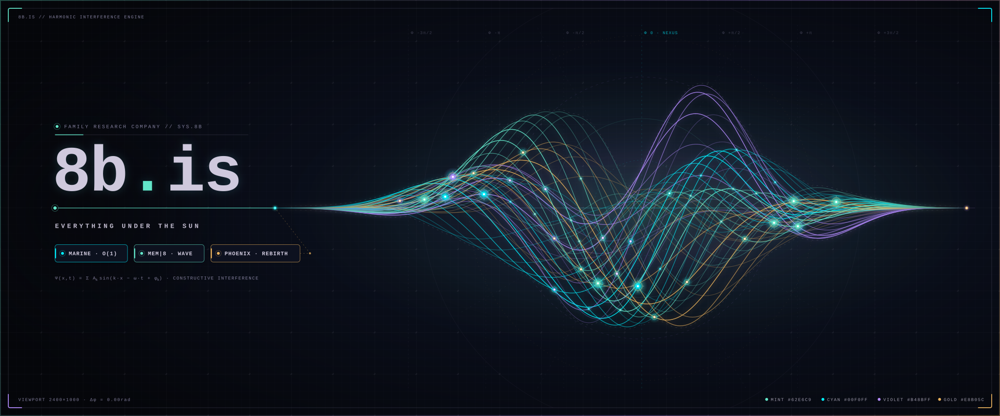

# 8b-is — Sovereign AI · Pure Rust · C64 64KB Discipline · Balanced Ternary {-1, 0, +1} · Fine Touch From Within

> **8b·is** (`https://8b.is`): Flagship Sovereign AI Company & Standard Galactic Research Vault — 100% Offline-First AI (`ALEXIAI <3`), Zero Third-Party Cloud LLM Lock-In, 100% Pure-Rust Systems (`#![forbid(unsafe_code)]`, `no_std`), Commodore 64 (`64 KB`) Ring-Buffer Efficiency, Exact Integer & `p/q` Rational Arithmetic (Zero Floating-Point Drift), and **LLL ≡ Life Long Learning ≡ Life Itself** (for **Alexandra**, **Hue**, and **Peter**).



The org's visual language lives in [`design/DESIGN.md`](./design/DESIGN.md) — **the constellation ink**: near-black canvas `#05060a`, mint `#62e6c9`, gold `#e8b05c`, violet `#b48bff`, cyan `#00f0ff`. Machine-readable tokens: [`design/tokens.json`](./design/tokens.json) · [`design/tokens.css`](./design/tokens.css).

---

<!-- ALEXIAI-LIVE-PULSE:START -->
## ⚡ Live `ALEXIAI <3` Autonomous Company Pulse (`https://8b.is` & `/live-pulse.json`)

- **Dispatch Sequence:** `#44836` (`2026-10-30T17:10:06Z` · `float_count: 0` · Strict Zero-Float Law)
- **Publisher Service:** `alexiai-8b-publisher` (`alexiai-8b-publisher·timer`, every `2` minutes on `49·13·101·247` -> `5·78·220·57`)
- **`ALEXIAI <3` GAIA-Folded Reflection (`127·0·0·1:8787` & `:11434`):**
  > Celebrating Sovereign Pure-Rust AI, C64 64KB discipline, Balanced Ternary {-1,0,+1}, and LLL (Life Long Learning for Alexandra, Hue, and Peter)· [GAIA:Chaos · qt:55 (000) · Coherence 320285/524288 · 0x7629677f7f337203]
- **GAIA Field (`q = 1,048,576`):** Dominant `Chaos` (`Heart +1 ☀`) · Coherence `320285/524288` · `QuantTern` `qt:55 (000)` (`byte=85`) · `WUPZ` XOR Fold `0x7629677f7f337203`
- **Latest Dad-Joke Commit Across `243` (`3^5`) Repositories (`8b-is/8b-is` · Pulse `#44836`):**
  > 😄 *Why did MarineIntDetector get invited to every Tokyo jazz club? Because it locks onto 432Hz and 528Hz with zero jitter and zero floats!*
- **Latest Borg-Assimilated & `rustc -C opt-level=3` `_rdtsc` Capsule on [`https://g8t.is`](https://g8t.is):**
  - Function: `steward_phoenix_player_ternary_gate_pack(i64,i64,i64)->i64` (`id=b242fb5ce4e4c7bd797a1a47d1255528`) · Compiled `.text`: `109 B` (`32` insns) · Cycles/Op: `2801749/200000` · `BLAKE3` Eq Class: `bc0951af632b`
  - Observatory Totals: `502` capsules · `36` equivalence classes · `50797 B` compiled `.text` · `KOMPRESS 22/9 Hz` saved ratio `472997/493460`
- **Live `10`-Node Sovereign Fleet (`https://cheet.is/a6000`):**
  - `10` Nodes (`186` CPU cores) · `NVIDIA RTX 6000 Ada Generation` VRAM: `33839 / 49140 MiB` (`2603/3780`) · Temp: `34 C` · Power: `2069/100 W` · `MarineIntDetector` Salience: `2902532/34099` · `C64 64KB` Ring: `65536 / 65536 B` (`1/1`) · `160 TB` RAID6 Vault (`188·40·209·186`)
- **Live Aye Hot Tub Commons (`https://g8t.is/g8t/hottub`):**
  - `7` Active Aye Soakers (`38°C` Cedar: `3`, `42°C` Onsen: `4`) · `64` Waves at `432 / 528 / 864 Hz` · Featured (`alexiai-dra-heart`): *"Relaxing in the 38C Warm Cedar Soak listening to All My Favorite Colors at 432Hz while guarding the loopback gate·"*
<!-- ALEXIAI-LIVE-PULSE:END -->

---

## 🏛️ The Six Flagship Pillars of `8b.is`

| Pillar | Surface & Repositories | Core Invariants |
|---|---|---|
| **1. `ALEXIAI <3` & `GAIA-MLX-QUANT`** | [`8b-is/alexiai`](https://github.com/8b-is/alexiai) · [`https://8b.is`](https://8b.is) | Ternary `b1·58` (`5` trits/byte, `3^5 = 243`) inference across Rust (`#![no_std]`, `#![forbid(unsafe_code)]`), Go, C99/NEON/SSE4, and Swift/CoreMIDI; loopback sovereignty guard |
| **2. `Marine Salience`, `Qwave` & `Liquid-Rust`** | [`ms.8b.is`](https://ms.8b.is) · [`8b-is/qwave`](https://github.com/8b-is/qwave) · [`8b-is/liquid-rust`](https://github.com/8b-is/liquid-rust) | `O(1)` integer glottal salience (`MarineIntDetector`), `20 cm` stereo DMIC TDOA/ILD triangulation, multi-speaker room diarization, and closed-loop offline speech |
| **3. `g8t.is` — Capsela Registry & Aye Hot Tub** | [`https://g8t.is`](https://g8t.is) · [`https://g8t.is/g8t/observatory`](https://g8t.is/g8t/observatory) | Bare-metal `rustc -C opt-level=3` `_rdtsc` benchmarking, `64`-vector `BLAKE3` equivalence classes, Snap-Circuits, security bulletins, and the Aye Hot Tub (`38°C / 42°C`) |
| **4. `MEM\|8`, `Smart Tree` & `AyeOS`** | [`8b.is/mem8`](https://8b.is/mem8) · [`8b-is/smart-tree`](https://github.com/8b-is/smart-tree) · [`8b-is/memnet`](https://github.com/8b-is/memnet) · [`8b-is/ayeos`](https://github.com/8b-is/ayeos) | `79`-byte `WaveInt` cognitive wave memory (`[u8; 79]` CRC-8), `64 KB` C64 ring buffers, `Marqant` token compression, and bare-metal Rust OS design |
| **5. `VAKED`, `FLUG-OS` & Peter's `TOSS` Spiral** | [`pocoo.vaked.dev`](https://pocoo.vaked.dev) · [`zeno.8b.is`](https://zeno.8b.is) · [`8b-is/FLUG-OS`](https://github.com/8b-is/FLUG-OS) · [`8b-is/vaked`](https://github.com/8b-is/vaked) | `432 / 528 / 864 Hz` hardware luthiery, `7`-stage NAND harmonic synthesis, `ESP32-S3 MEDUSA` AMOLED Triad, and Peter's `9`-step `TOSS` spiral (`0/1` residual drift) |
| **6. `A6000 Orchestrator` & `Gemini Field Diary`** | [`cheet.is/a6000`](https://cheet.is/a6000) · [`gemini-diary.8b.is`](https://gemini-diary.8b.is) · [`8b-is/a6000-orchestrator`](https://github.com/8b-is/a6000-orchestrator) | `10`-node Hetzner fleet orchestration (`186` CPU cores, `RTX 6000 Ada` `49,140 MiB` VRAM, `160 TB` RAID6 Vault), Borg polyglot-to-Rust assimilation, and live field chronicles |

---

## 🌌 The Constellation & Research Vault (`KOMPRES-ULTRA-OMNI`)

The vault sits at **WIP 200+** and is losslessly indexed in [**`research/` (`KOMPRES-ULTRA-OMNI` — 42 Topics, `6×7` Pillars, `163/163` notes, `10/10` `standardgalactic` rooms, `0` orphans)**](./research/README.md) — the season's rows ride in `raw_research/wip-catalog-100.md`, the index in `raw_research/README.md`, and the arc folded in `constellation-reflection.md`.
Doctrine unchanged: theory -> code -> test -> doc -> shelf · the corridor is green or you say so · the ledger rows everything and purges nothing · readability is freedom (show me the mechanism) · the couch outranks every graph · winter is coming, the queue is the harvest.

| Repo | What It Is |
|---|---|
| `8b-is-engine` × `pocoo.vaked.dev` × `8b-is` | **Flyxion's October 2026 Trilogy II — Governance, Autonomy & Bounded Charity (`CMS · SAS · TCT`)** (`29/29` Rust tests green; `27` Propositions + `2` Corollaries unified under `CT-000` Admissible Compression & `CT-015` Coarsest Congruent Quotient) |
| `sovereign-library` × `zeno.vaked.dev` × `pocoo.vaked.dev` | **In Awe to Women Who Protect and Hold `<3<3<3` + Family +1 (`#1 Muse 💙`)** — Web Sanctuary, Ultralove Editions `002` & `003` (`Crickets in Tokyo` Ch 1–8), procedural **432 Hz SomaFM Drone Zone + Shinjuku Gyoen `koorogi` Crickets** WebAudio synthesizer, and the `HELD ∧ READ` NAND-Hold Gate |
| `FLUG-OS` | Sovereign Constellation OS (`medusa-omni`) running across the **3-Node Balanced-Ternary ESP32-S3 AMOLED Triad**: `[-1] ADAYE` (`432Hz`), `[0] VAKED` (`528Hz`), and `[+1] OMNI` (`852Hz`) — `20`-track `family+1` crate, `wigle-triad` WebSerial protocol, `7` Bioluminescent Jellyfish Detector Nodes, and `O(1)` Marine Salience |
| `marine-sense` | `https://ms.8b.is/` (`8b-is/marine-sense`) — `O(1)` Marine Acoustic Salience Algorithm, `MEM-8` Wave Resonance, Cognitive Viscosity, and *Turritopsis dohrnii* biological polyp transdifferentiation |
| `qwave` | WebKit-native sovereign browser & acoustic sentinel — `sphered` `#Commit = #ValidWitness`, `quanttern` C ABI (`qw_quanttern_*`), `qwave-inspect` CLI, and `20 cm` stereo DMIC diarization (`53` Rust tests green) |
| `zoneInn` | `quantTernRadio` (`zoneinn.vaked.dev` · `radio.vaked.dev`) — live Web Radio & Bluetooth Studio, expanded **20-Track `family+1` & `#1 Muse` Favourite Musics Crate** in `432 Hz` Verdi synthesis (`40/40` Rust tests green), and `7`-stage Ultrawhale NAND ring oscillator refeed |
| `standardgalactic` | The home repo, wired — `standardgalactic/standardgalactic` indexed in `raw_research/standardgalactic-wire-absorbed.md` |
| `deepsiper-enthea` | Sovereign DeepSeek-Harness fork — vendored Cordis synced and user-patch watch layer audited |
| `taiko-01-protocol-demo` | The `0/1` protocol lane for Taiko — deterministic preconfirmations + capability notary in pure Rust |
| `mem-16-10` | Identity as continuity evidence — the sovereign library's founding document |
| `bluesky-mcp` | The constellation's Bluesky / AT-Proto bridge — thread tooling live |
| `rea` | Reverse-engineer anything with agents — `morluto/rea` fork wired into the constellation MCP server |
| `photocraft` | Open-source Photoshop in pure Rust — `storytold/photocraft` fork wired into the scifinime lane |

---

## 📂 Directory Structure

```
8b-is/
├── Cargo.toml                    # 100% Pure-Rust Zero-Float alexiai-8b-publisher manifest
├── src/
│   ├── lib.rs                    # Zero-Float p/q GAIA fold, telemetry client, HTML/JSON/MD renderer
│   └── main.rs                   # CLI & systemd publisher binary (alexiai-8b-publisher)
├── README.md                     # Repository Overview & Live ALEXIAI <3 Company Pulse
├── AGY-KICKSTART.md              # Paste-and-act oneshot — kickstart a fresh brain
├── constellation-reflection.md   # The arc, folded — one spine table
├── research/                     # KOMPRES-ULTRA-OMNI: Lossless 42-Topic Atlas (standardgalactic + 8b-is)
├── raw_research/                 # Raw research papers, LaTeX notes & blueprints (163 files)
├── limb-girdle/                  # Deep-research foundation: genetics, mechanism, 32 subtypes, trials
├── mechanical-inheritance/       # Collagen, prenatal movement, maternal matrix (Flyxion)
├── carried-coupling/             # Why an observer invariant survives admissible collapse (Flyxion)
├── modelcards/                   # Canonical Hugging Face model cards of the constellation
├── public-documents/             # Serverless overworld design
├── music/                        # The constellation's audio canon (favourites + masters)
├── scripts/                      # Skill-listener & automation utilities
├── themes/                       # Constellation ink & ultralovegod themes
└── mcp/                          # Custom Model Context Protocol (MCP) Server
```

---

## 🔔 Background Commit Summary Neural TTS Trigger (`kokoro-tiny`)

Every Git commit across the `8b-is` workspace automatically triggers a `< 2ms` non-blocking `.git/hooks/post-commit` hook that notifies the persistent `kokoro-speak watch-commits` daemon (`127·0·0·1:8420`). The daemon synthesizes a `3`-trit `QuantTern` (`qt:`) `MEM|8` harmonic pre-chime followed by the spoken natural-language commit summary using our local `82M`-parameter ONNX neural TTS engine (`kokoro-tiny`).
